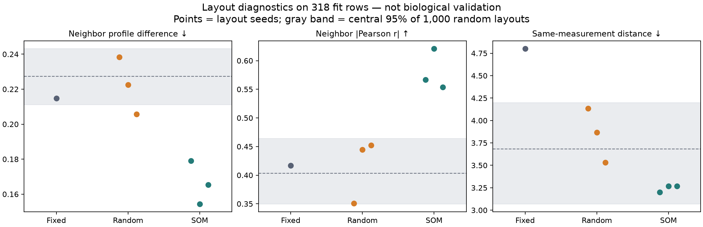

# Weekly professor discussion — 31 October 2026

**Student:** Yu Dinh. **Purpose:** report useful lessons from separate learning experiments, not claim that the thesis hypothesis is already proven. Prepared discussion notes; no new meeting, attendance or professor approval is assumed.

## One-minute summary to say in the meeting

> Last week we learned that tracing an image pixel to a feature is not the same as proving that an explanation is reliable. This week, after receiving the SOM2IMG repository, we ran its actual layout algorithm on Wisconsin and compared it with fixed and lossless random layouts. SOM preserved all 30 features and placed more similar feature profiles next to each other. Its exact neighborhoods still changed across seeds, and the small prediction improvement is not enough to establish superiority. We also reproduced the authors' documented 8-bit conversion issue on our inputs, which is why our controlled comparison keeps floating-point values. Our next question is whether the better-organized layout also produces more stable and faithful explanations in the original feature space.

## Work completed / evidence

- Inspected and pinned the [supplied author repository](https://github.com/Kerbash/tab2img-bench/tree/dc0ef691db733ebcba4d13b53ca58e258f76ef0a). Verified its run interface, feature mapping, spillover collision rule, training-fold fitting and numerical conversion. The repository describes a newer 51-dataset study; it is not automatically the same version as our earlier nine-dataset manuscript.
- Completed [Experiment 07](../experiments/07_som2img_layout/README.md): seven layouts crossed with three CNN seeds, 21 models total. Fitting/inner-stop/evaluation sizes: **318/79/86**. The prior learning-test partition was not scored or transformed.
- Saved the [pre-run protocol](../experiments/07_som2img_layout/protocol.json), [all results/mappings/predictions](../experiments/07_som2img_layout/results.json), [reproduction script](../scripts/som2img_learning.py) and four figures. **94 local tests and 18 upstream tests pass.** Independent execution reproduced the JSON and figures exactly on this environment.

## Three findings worth discussing

### 1. SOM organizes similar measurements, but one map is not definitive

All seven layouts preserved 30/30 features with exact scaled-value recovery. Across three layouts per stochastic method, mean adjacent absolute Pearson correlation was **0.580 for SOM versus 0.416 for random**. This is a training-profile organization check, not independent biological validation.

SOM's mean neighbor-set overlap across seeds was only **0.211 Jaccard** (random: 0.035). Same-measurement mean/SE/worst groups were closer than in the fixed grid, but their distance remained within our descriptive random-layout reference interval. We should not claim proven semantic enrichment.

**Why it matters:** our thesis must test stability and domain meaning separately from whether the map looks organized. [Layout diagnostics and limitations](../experiments/07_som2img_layout/README.md#3-feature-preservation-and-layout-structure).

### 2. Prediction is strong in this small exercise, not an interpretability result

| Layout | Mean evaluation accuracy | Mean macro F1 | Mean log loss ↓ |
|---|---:|---:|---:|
| Fixed | 97.67% | 0.9751 | 0.0543 |
| Lossless random | 98.32% | 0.9820 | 0.0744 |
| SOM2IMG | 98.97% | 0.9890 | 0.0536 |

SOM exceeds random by **0.65 percentage points**, less than one extra correct record per run on average. These are dependent repeats on **86 previously studied validation records**, not an independent test or statistical proof of superiority. All models reached the fixed training cap. No tabular baseline was newly fitted, and these numbers should not be compared directly with last week's different test partition. [All runs and setup](../experiments/07_som2img_layout/README.md#4-prediction-promising-small-exploratory-differences).

**Why it matters:** this supports continuing a controlled explanation comparison, not switching the thesis into a claim that SOM-CNN beats tabular ML.

### 3. Input integrity matters before interpreting a heatmap

Using the upstream default uint8 export, **28 values across nine evaluation records** differed by more than 0.5 from clipped export. One real scaled `area_worst` value of **1.030766 became 0.023529**. Our float32 inputs preserve the value to ordinary casting precision. The authors already document this behavior; our contribution this week is confirming its occurrence on our selected inputs, not discovering a new bug. [Author encoding source](https://github.com/Kerbash/tab2img-bench/blob/dc0ef691db733ebcba4d13b53ca58e258f76ef0a/src/tab2img/pipeline.py); [our numerical audit](../experiments/07_som2img_layout/README.md#5-separate-numerical-audit-a-pixel-can-change-before-the-cnn-sees-it).

**Why it matters:** a stored feature map can be correct while the image values are distorted. We did not measure the predictive effect of that distortion; our layout experiment avoids it for all methods.

## What last week's work adds to the story

- **Feature explanations need tests:** on 12 selected validation cases, IG/SHAP magnitude agreement averaged 0.985 Spearman. Five-feature replacement exceeded the random mean in 12/12 cases for IG, versus 5/12 for the naive Grad-CAM coordinate proxy. This questions a particular use of regional localization as feature ranking, not Grad-CAM generally. [Explanation experiment](../experiments/03_wisconsin_explanations/README.md).
- **A plausible picture can hide a shortcut:** background-correlated synthetic models fell from 100% to 0% accuracy when backgrounds were reversed; independent-background controls stayed at 100%. A reference leaving the background unchanged still produced 100% foreground absolute IG mass. That is a contrast-dependent explanation, not proof the model ignores backgrounds. [Controlled shortcut experiment](../experiments/04_shortcut_sandbox/README.md).
- **Combined lesson:** preserve the input → check layout stability → test model reliance → evaluate domain usefulness. We have local evidence for the first three topics, but have not established a genomic interpretation benefit or thesis novelty.

## Problems / decisions for the professor

1. **Version:** Is the supplied 51-dataset code the intended reference for our thesis, or should we also reproduce the older IEEE-version configuration?
2. **Contribution:** Should the next bounded exercise focus on attribution stability and faithfulness across fixed/random/SOM layouts, using the frozen models we now have?
3. **Domain usefulness:** For later genomic experiments, what is the intended evidence of useful interpretation—predefined pathway coherence, expert review, robustness, or another explicit criterion? The current morphology exercise cannot answer that biological question.

## Work scheduled, in priority order

1. Walk through the figures and rehearse the difference between input value, feature grouping, model attribution and biological meaning.
2. Freeze an attribution-comparison protocol, then trace the same cases and target scores back to named features across layouts. Include reference sensitivity and matched feature-replacement controls; do not select the best SOM seed.
3. Return to the preserved TCGA/Xena pilot after agreeing on the interpretation target and cohort limitations. No additional genomic training is needed for this week's learning deliverable.

**Are we on track?** Yes, for the professor's separate-experiment learning phase. We now use the supplied SOM code and can show measured findings with controls. The broader multi-dataset biological validation and literature-based novelty assessment remain future thesis work.
