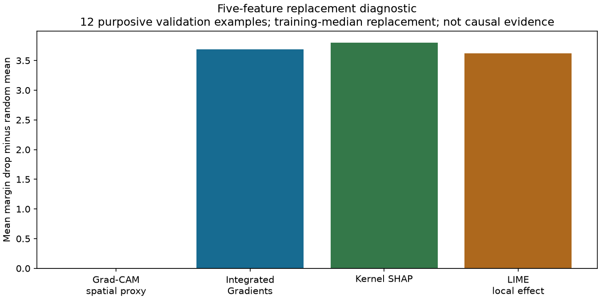
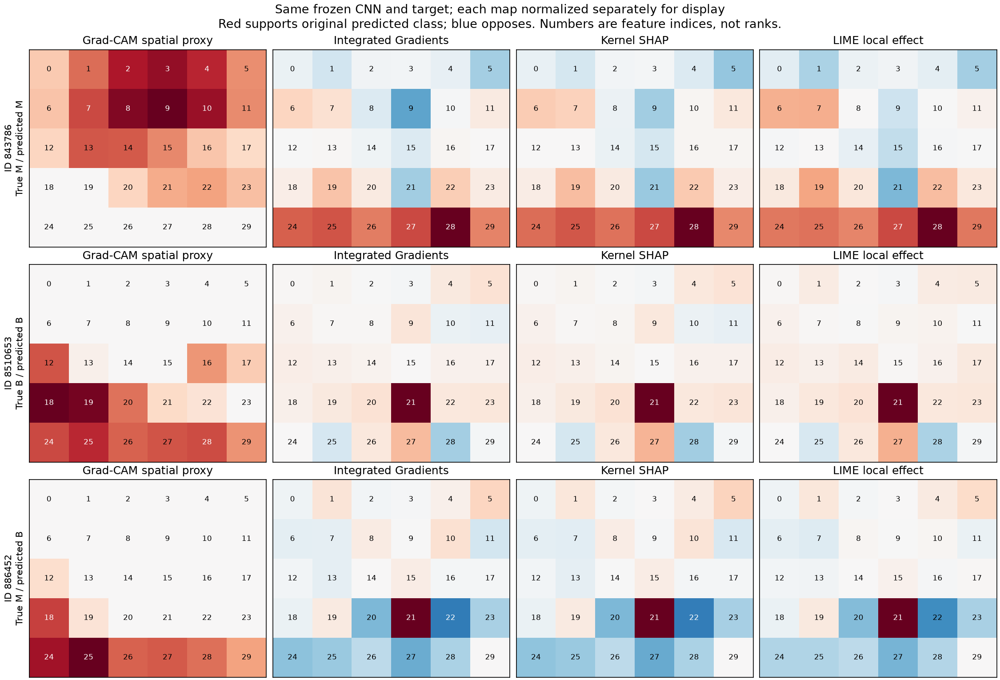

# Experiment 03 — explaining a frozen Wisconsin CNN

Completed 23 October 2026. This is an explanation-learning exercise, not a new classifier comparison, clinical analysis, or final thesis experiment. [Protocol](protocol.json) · [computed evidence](results.json) · [implementation](../../scripts/wisconsin_explanations.py).

## Question and setup

Can we trace a CNN explanation to the original 30 features, and do different explanations behave similarly when checked?

We froze the first listed CNN seed from [Experiment 02](../02_wisconsin_models/README.md), including its weights, scaler and 5×6 row-major mapping. The 12 primary examples are the first six validation records of each true class, in saved order. The first validation error is an extra illustration only. This is a purposive learning subset, not a representative evaluation sample. No test-set explanations, new classifier fitting, threshold changes or hyperparameter search occurred.

All methods explain the **same score**: the logit margin supporting the CNN's original predicted class. This target stays fixed when features or model weights change. The reference is the coordinatewise median of the 397 training rows. A zero-reference sensitivity check uses the training minima in scaled coordinates; neither reference is necessarily an observed or biologically plausible sample.

## What each method answers

| Method | Computation used here | What not to infer |
|---|---|---|
| Grad-CAM | Positive 5×6 localization map at the second convolution, before ReLU | A map cell is not an isolated input-feature contribution: convolution mixes neighboring inputs |
| Integrated Gradients (IG) | Input attribution relative to a reference; decode its 30 pixel scores through the saved mapping | Reference-relative contribution is not causation or reference-free importance |
| Kernel SHAP | Mask tabular features to the training-median vector, re-encode, query the same CNN | This one-background masking game does not model conditional feature dependence |
| LIME | Fit a local linear surrogate to tabular perturbations passed through that CNN | Local slopes are not automatically additive feature contributions or globally faithful explanations |

Grad-CAM is introduced as coarse localization, whereas IG targets input attribution. SHAP provides additive feature explanations and LIME fits a local interpretable surrogate. These are related but different questions. Sources: [Grad-CAM](https://arxiv.org/abs/1610.02391), [IG](https://arxiv.org/abs/1703.01365), [SHAP](https://arxiv.org/abs/1705.07874), [LIME](https://arxiv.org/abs/1602.04938).

For comparison, our reported **LIME local effect** is its standardized coefficient multiplied by `(sample − training median) / training standard deviation`. This is our explicitly labeled baseline-relative surrogate comparison, not a new explanation method or standard SHAP value. Raw LIME coefficients, local predictions, fit scores and scales are retained. LIME's Gaussian neighborhoods can leave the observed data range. See the [official tabular API](https://lime-ml.readthedocs.io/en/latest/lime.html#module-lime.lime_tabular).

Implementation settings: IG starts at 512 Gauss–Legendre steps and refines only for a preset numerical residual threshold; Kernel SHAP uses 512 samples with no L1 feature selection; LIME uses 2,048 samples and all 30 features. Two sampling seeds are checked for SHAP/LIME. Each base sampling/deletion seed in the protocol is offset by the validation position. Captum's Grad-CAM positive-only option is explicitly enabled. [IG API](https://captum.ai/api/integrated_gradients.html), [Grad-CAM API](https://captum.ai/api/layer.html#gradcam), [Kernel SHAP API](https://shap.readthedocs.io/en/latest/generated/shap.KernelExplainer.html).

## Results: same model, same examples

All numbers below are computed from [results.json](results.json), not taken from a paper. Means use only the 12 primary cases.

| Pair | Mean Spearman, absolute magnitudes | Mean top-five Jaccard |
|---|---:|---:|
| IG versus Kernel SHAP | 0.985 | 0.917 |
| IG versus LIME local effect | 0.877 | 0.821 |
| IG versus Grad-CAM coordinate proxy | 0.096 | 0.090 |
| IG: median versus zero reference | 0.520 | 0.479 |
| Kernel SHAP: two sampling seeds | 0.984 | 0.972 |
| LIME local effect: two sampling seeds | 0.986 | 0.944 |

Agreement describes consistency, not truth; absolute-magnitude agreement also ignores contribution sign. IG and SHAP share a reference, which can contribute to agreement. Changing the IG reference changed rankings substantially in these examples.

### Feature-replacement diagnostic

Replace the top five features by their training medians and measure the drop in the fixed target margin. Rank by **signed support**, not absolute magnitude. Compare against the mean of 100 random five-feature replacements on the same example; all methods share those random controls. Results for one and three features are also saved. Negative excess means the selected replacement reduced the target less than the random mean.

| Ranking | Mean margin drop beyond random mean | Cases exceeding random mean |
|---|---:|---:|
| Grad-CAM coordinate proxy | 0.008 | 5/12 |
| IG | 3.692 | 12/12 |
| Kernel SHAP | 3.803 | 12/12 |
| LIME local effect | 3.621 | 12/12 |

This challenges **our naive use of Grad-CAM coordinates as feature ranks**, not Grad-CAM's usefulness for its intended localization task. It does not establish a general ordering of explanation methods. Replacement can create unrealistic combinations of correlated measurements; no conditional masking, causal inference, confidence interval or biological validation is supplied.



### Numerical and model-dependence checks

- All 52 IG calculations (median/zero references and two randomized models across 13 examples) met the predefined normalized completeness tolerance of 0.001; maximum residual was 0.000351. Completeness checks numerical accounting, not semantic correctness.
- Kernel SHAP's maximum additivity residual was 1.78e-15. Additivity alone does not certify accurate individual contributions; the fitting procedure constrains their sum.
- As an analytic software control, we also explained the frozen logistic regression. Its exact reference-relative effects are `target_sign × coefficient × (sample − median)`. Maximum Kernel SHAP error was 1.96e-7; maximum LIME local-effect error was 0.00126. These linear effects are not ground truth for the CNN.
- LIME's primary-case mean weighted neighborhood R² was 0.954 (range 0.922–0.972). This measures fit to its sampled neighborhood, not realistic-data faithfulness.
- Head-only and full parameter resets changed the explanations. Mean IG magnitude correlation with the trained model was 0.724 and 0.469; Grad-CAM's was −0.680 and −0.468. Nonzero agreement can persist through input/reference structure. One reset seed and two reset conditions are a limited diagnostic, **not a universal sanity-test pass** or full replication of [Adebayo et al.](https://arxiv.org/abs/1810.03292). The original class target never changes.

### Trace an actual wrong prediction

Validation ID **886452** is malignant but the frozen CNN predicts benign. Feature index **21**, `texture_worst`, occupies zero-based `(row 3, column 3)`. Its scaled value is 0.2763 versus training median 0.3753. Its contributions toward the **incorrect benign prediction** are IG +0.9675, SHAP +0.9735 and LIME local effect +0.9213. The Grad-CAM value at that coordinate is zero. The original benign margin is +0.8106.

This demonstrates what tracing does: it names a contribution to a particular model decision, even when that decision is wrong. It does not establish that the measurement causes a diagnosis. This extra case does not enter the headline averages.



Maps are independently normalized for display, so color intensity cannot compare effect sizes across panels. Red supports the original predicted class; blue opposes it. Grid labels are feature indices, not ranks; the complete mapping is in the result file.

## Reproduce and verify

Use Python 3.12 and [the pinned environment](../../requirements-learning.txt). The official Wisconsin raw files and frozen local Experiment 02 checkpoints must exist; see [their reproduction instructions](../02_wisconsin_models/README.md#reproduce-and-verify). Load only locally generated trusted checkpoints.

```sh
MPLCONFIGDIR=/private/tmp/css700-matplotlib XDG_CACHE_HOME=/private/tmp/css700-cache .venv/bin/python -m scripts.wisconsin_explanations --output-dir /private/tmp/css700-explanation-repeat
.venv/bin/python -m unittest discover -s tests -v
cmp experiments/03_wisconsin_explanations/results.json /private/tmp/css700-explanation-repeat/results.json
```

Choose a fresh output directory. The script refuses to overwrite an existing result. A complete repeat in a separate directory produced byte-identical results on this machine. Source/model/protocol hashes, vectors, selected features, sampling checks and diagnostic scores are retained. Cross-platform bitwise identity is not promised.

## Lesson and next step

Exact coordinate recovery is necessary for tracing, but does not make every spatial explanation an exact feature attribution. Evaluate input-level and regional explanations separately. Next, use the [controlled shortcut exercise](../04_shortcut_sandbox/README.md) to see why the choice of reference and evaluation intervention matter. A learned SOM layout remains a separate future experiment.
