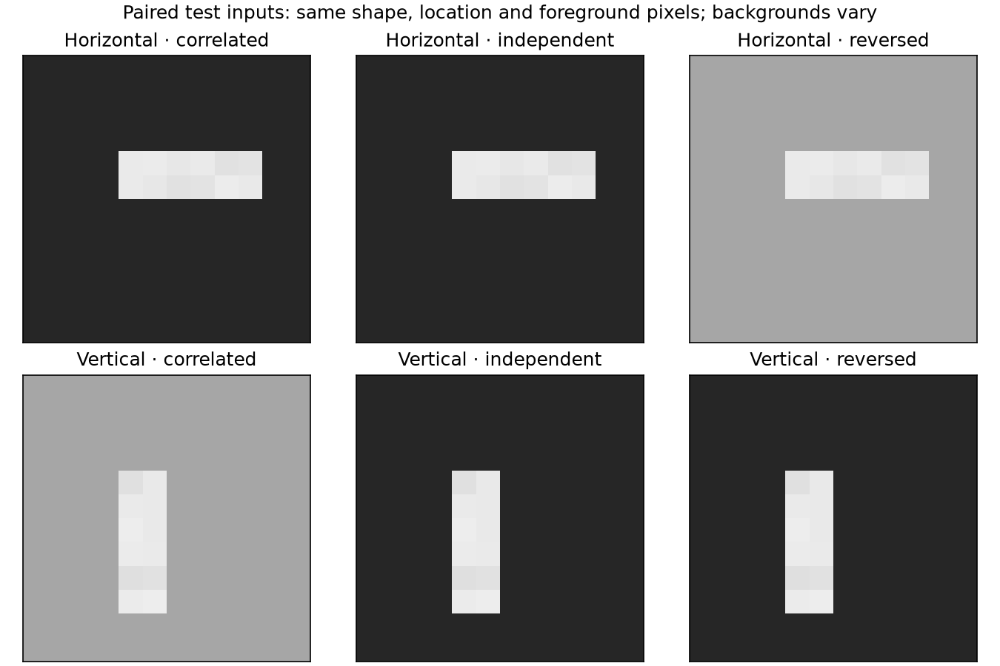
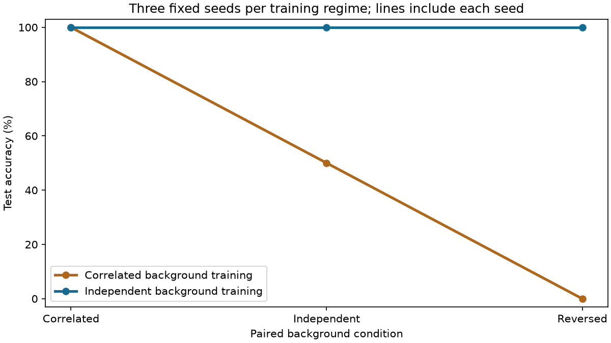
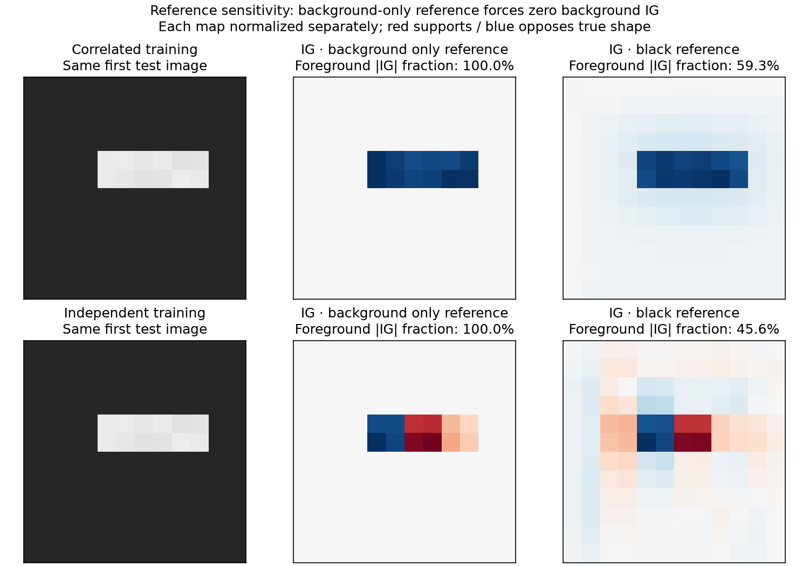

# Experiment 04 — shape or background?

Completed 23 October 2026. This synthetic experiment follows my advisor's question about whether an image classifier recognizes the object or its background. It isolates that distinction using simple shapes. [Protocol](protocol.json), [results](results.json) and [generator](../../scripts/shortcut_sandbox.py).

## Controlled question

We classify horizontal versus vertical bars in 12×12 grayscale images. The shape occupies 12 pixels, with small location/intensity variation; 132 pixels are background. There are 512 training, 128 validation and 256 test examples, balanced by shape. Data seeds are 7101, 7102 and 7103 respectively.

Two training conditions use identical foregrounds and labels:

1. **Correlated background:** horizontal shapes have a dark background; vertical shapes have a light background.
2. **Independent-background control:** both backgrounds occur equally often within each shape class.

Each uses the same 1,282-parameter CNN and three predefined seeds. Validation loss selects checkpoints within the corresponding training regime. All six checkpoints are selected before test scoring. No settings are changed after viewing results.

The paired test views retain the foreground pixels, shape positions and labels while changing only the background assignment: correlated, independently balanced or reversed. Prediction changes can therefore be attributed to the changed background within this synthetic construction. The experiment does not test shortcuts in Wisconsin or other real data.



## Results

The table summarizes [results.json](results.json). All three seeds produced the displayed accuracy, giving a seed SD of zero for this construction. Variation across other generators or real images has not been measured.

| Training condition | Correlated test | Independent test | Reversed test | Predictions flipped after reversal |
|---|---:|---:|---:|---:|
| Correlated background | 100% | 50% | 0% | 100% |
| Independent background | 100% | 100% | 100% | 0% |

Macro-F1 is respectively 1.000 / 0.500 / 0.000 and 1.000 / 1.000 / 1.000. Mean true-class probability dropped by 0.99983 under reversal for the correlated-background models. The independent-background controls changed by −0.00069 on the same scale: their predictions were invariant here, though their scores were not perfectly identical.



The original test accuracy alone could not distinguish these model groups. The intervention exposed background dependence. This supports our controlled demonstration only; it does not establish that one control guarantees robust generalization to every unseen background.

## Why the attribution reference matters

We explain the first eight correlated test images for seed 7201 in each training condition. The target is always the true shape's logit margin. Two IG references are compared:

- **Background-only:** remove the shape but leave the input's background unchanged. This asks about adding the foreground to that specific background.
- **Black:** compare against an all-zero image. This changes the reference question; it is not designated as a universally correct alternative.

IG includes an input-minus-reference factor. Where that difference is zero, the contribution is zero. Consequently, the background-only reference forces all background IG to zero even when a model depends strongly on background. This follows from the method's computation, not an implementation failure. [IG paper](https://arxiv.org/abs/1703.01365), [Captum's definition and baseline/completeness options](https://captum.ai/api/integrated_gradients.html).

| Training condition | Mean foreground share of absolute IG: background-only reference | Same share: black reference |
|---|---:|---:|
| Correlated background | 100% | 35.8% |
| Independent background | 100% | 36.9% |

The foreground-attribution score alone fails to distinguish the two model groups. For the correlated model, the background-only images already receive a mean true-class probability of **0.99995** across the eight cases. Absolute attribution mass also omits sign: in the first illustrated shortcut-model example, the shape attribution is negative and opposes the true class. Its location on the object does not imply positive support for that class.



Raw mass also depends on region size (12 foreground versus 132 background pixels). Results retain absolute sums and per-pixel means for both regions. All 32 IG calculations met the predefined normalized completeness tolerance of 0.001; maximum residual was 0.000952. Numerical completeness does not resolve which reference question is useful.

The results support combining a stated attribution reference with behavioral controls. Spatial overlap alone was insufficient to identify background reliance in this experiment. This concern is consistent with the motivation for the sanity checks of [Adebayo et al.](https://arxiv.org/abs/1810.03292), although the present study uses a different experimental design.

## Limits

- This intentionally simple generator makes a large, easy background cue. No effect size is extrapolated to real datasets.
- One generated dataset split and three initialization seeds are not three independent datasets. Attribution uses eight fixed cases and one model seed per regime.
- The independent-background model may still use some background-sensitive computations despite unchanged predicted classes in the tested views.
- No dog/cat dataset, pretrained vision model, learned tabular layout or biological annotation is involved.

## Reproduce and verify

With [the pinned environment](../../requirements-learning.txt), no external download or Wisconsin checkpoint is required for this synthetic experiment.

```sh
MPLCONFIGDIR=/private/tmp/css700-matplotlib XDG_CACHE_HOME=/private/tmp/css700-cache .venv/bin/python -m scripts.shortcut_sandbox --output-dir /private/tmp/css700-shortcut-repeat --artifact-dir /private/tmp/css700-shortcut-weights
.venv/bin/python -m unittest discover -s tests -v
cmp experiments/04_shortcut_sandbox/results.json /private/tmp/css700-shortcut-repeat/results.json
```

Use fresh directories; existing results/checkpoints are not overwritten. The full six-model repeat produced byte-identical results on this machine. Tests check exact foreground pairing, shape labels, within-class background balance, generation determinism, metric recomputation, checkpoint selection, and the zero-background-IG identity. Tracked outputs include source/protocol/data hashes, probabilities, training histories, attribution arrays and numerical checks. Checkpoint files remain local and ignored by Git.
