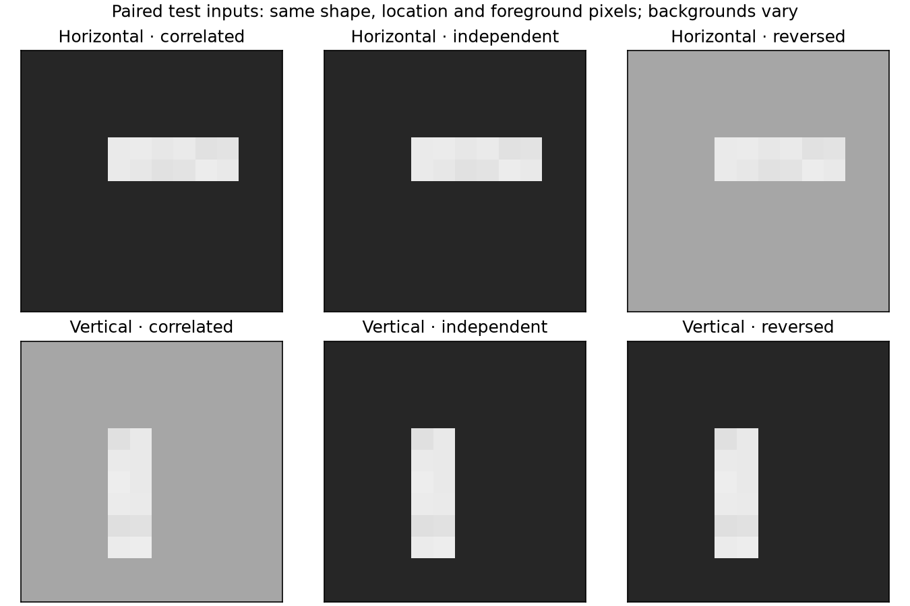
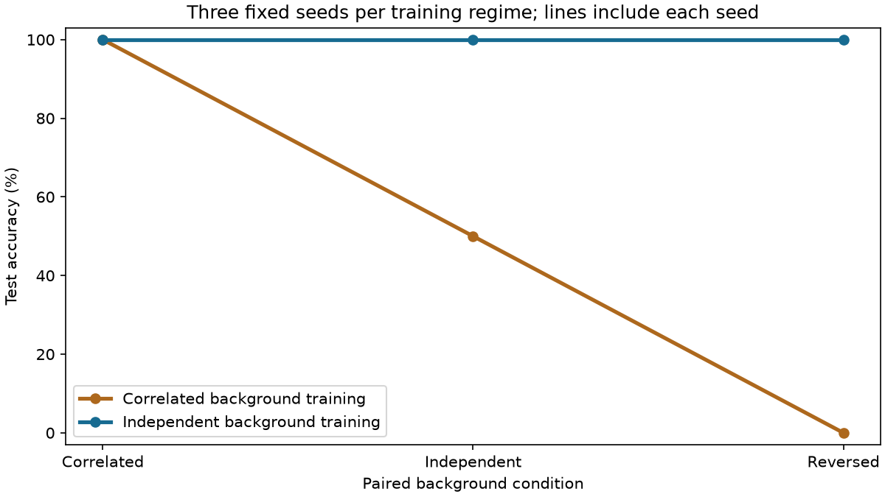
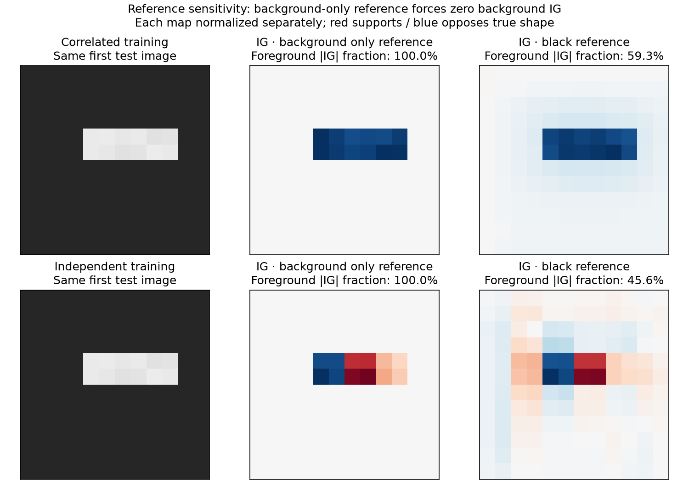

# Experiment 04 — shape or background?

Completed 23 October 2026. A controlled synthetic learning exercise inspired by the professor's “ears or background?” question. This is **not** an additional real thesis dataset, reproduction of a published experiment, or evidence of a shortcut in Wisconsin. [Protocol](protocol.json) · [computed results](results.json) · [generator and experiment](../../scripts/shortcut_sandbox.py).

## Controlled question

We classify horizontal versus vertical bars in 12×12 grayscale images. The shape occupies 12 pixels, with small location/intensity variation; 132 pixels are background. There are 512 training, 128 validation and 256 test examples, balanced by shape. Data seeds are 7101, 7102 and 7103 respectively.

Two training conditions use identical foregrounds and labels:

1. **Correlated background:** horizontal shapes have a dark background; vertical shapes have a light background.
2. **Independent-background control:** both backgrounds occur equally often within each shape class.

Each uses the same 1,282-parameter CNN and three predefined seeds. Validation loss selects checkpoints within the corresponding training regime. All six checkpoints are selected before test scoring. No settings are changed after viewing results.

The paired test views keep every foreground pixel, shape position and label unchanged. Only the background assignment changes: correlated, independently balanced, or reversed. A shape-based decision should be stable to these particular changes; a changed prediction demonstrates sensitivity to the changed background, not a real-world causal or clinical conclusion.



## Results

These are our measured synthetic results from [results.json](results.json). Every one of the three seeds has the displayed accuracy, so seed SD is zero here; that does not mean zero uncertainty for different generators or real images.

| Training condition | Correlated test | Independent test | Reversed test | Predictions flipped after reversal |
|---|---:|---:|---:|---:|
| Correlated background | 100% | 50% | 0% | 100% |
| Independent background | 100% | 100% | 100% | 0% |

Macro-F1 is respectively 1.000 / 0.500 / 0.000 and 1.000 / 1.000 / 1.000. Mean true-class probability dropped by 0.99983 under reversal for the correlated-background models. The independent-background controls changed by −0.00069 on the same scale: their predictions were invariant here, though their scores were not perfectly identical.



The original test accuracy alone could not distinguish these model groups. The intervention exposed background dependence. This supports our controlled demonstration only; it does not establish that one control guarantees robust generalization to every unseen background.

## Why the attribution reference matters

We explain the first eight correlated test images for seed 7201 in each training condition. The target is always the true shape's logit margin. Two IG references are compared:

- **Background-only:** remove the shape but leave the input's background unchanged. This asks about adding the foreground to that specific background.
- **Black:** compare against an all-zero image. This changes the reference question; it is not designated as a universally correct alternative.

IG includes an input-minus-reference factor. Where that difference is zero, the contribution is zero. Consequently, the background-only reference forces all background IG to zero even when a model depends strongly on background. This follows from the method's computation, not an implementation failure. [IG paper](https://arxiv.org/abs/1703.01365), [Captum's definition and baseline/completeness options](https://captum.ai/api/integrated_gradients.html).

| Training condition | Mean foreground share of absolute IG: background-only reference | Same share: black reference |
|---|---:|---:|
| Correlated background | 100% | 35.8% |
| Independent background | 100% | 36.9% |

Thus a “100% attribution on the object” score does not establish that the classifier relies appropriately on shape. For the correlated model, the background-only images themselves already receive mean true-class probability **0.99995** across these eight cases. Absolute mass ignores sign; the first illustrated shortcut-model shape attribution is negative, opposing the true class. Do not describe this as positive evidence for the correct object merely because the highlighted pixels outline it.



Raw mass also depends on region size (12 foreground versus 132 background pixels). Results retain absolute sums and per-pixel means for both regions. All 32 IG calculations met the predefined normalized completeness tolerance of 0.001; maximum residual was 0.000952. Numerical completeness does not resolve which reference question is useful.

The lesson is to combine explicitly defined attribution questions with behavioral controls, not to treat an attractive picture or an overlap score as sufficient validation. This is consistent with the motivation for explanation sanity checks in [Adebayo et al.](https://arxiv.org/abs/1810.03292), but our exercise is not their benchmark.

## Limits

- This intentionally simple generator makes a large, easy background cue. No effect size is extrapolated to real datasets.
- One generated dataset split and three initialization seeds are not three independent datasets. Attribution uses eight fixed cases and one model seed per regime.
- The independent-background model may still use some background-sensitive computations despite unchanged predicted classes in the tested views.
- No dog/cat dataset, pretrained vision model, learned tabular layout or biological annotation is involved.

## Reproduce and verify

With [the pinned environment](../../requirements-learning.txt), no external download or Wisconsin checkpoint is required for this synthetic experiment.

```sh
MPLCONFIGDIR=/private/tmp/css700-matplotlib XDG_CACHE_HOME=/private/tmp/css700-cache .venv/bin/python -m scripts.shortcut_sandbox --output-dir /private/tmp/css700-shortcut-repeat --artifact-dir /private/tmp/css700-shortcut-weights
.venv/bin/python -m unittest discover -s tests -v
cmp experiments/04_shortcut_sandbox/results.json /private/tmp/css700-shortcut-repeat/results.json
```

Use fresh directories; existing results/checkpoints are not overwritten. The full six-model repeat produced byte-identical results on this machine. Tests check exact foreground pairing, shape labels, within-class background balance, generation determinism, metric recomputation, checkpoint selection, and the zero-background-IG identity. Tracked outputs include source/protocol/data hashes, probabilities, training histories, attribution arrays and numerical checks. Checkpoint files remain local and ignored by Git.
