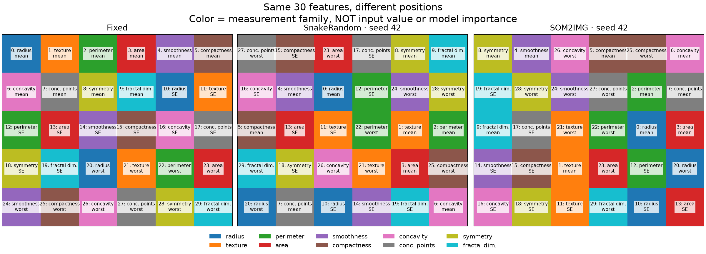
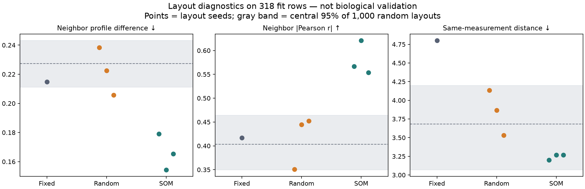
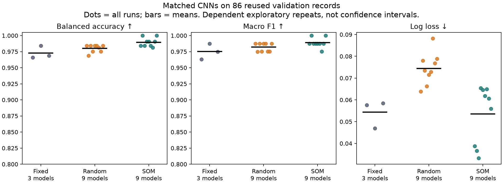
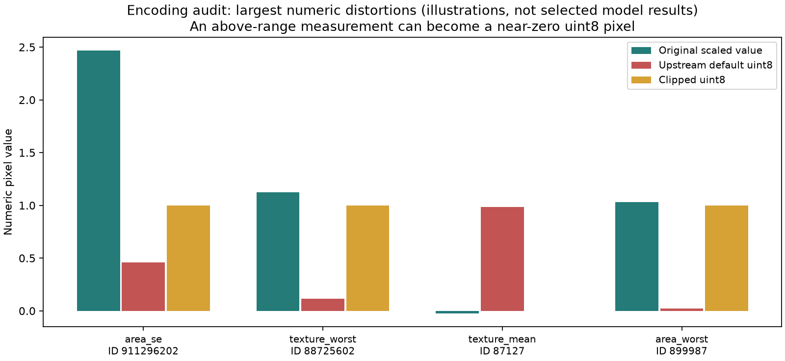

# Experiment 07 — SOM2IMG: layout, preservation, and a matched CNN comparison

Completed **31 October 2026**. Separate learning experiment on Wisconsin Diagnostic; not a clinical study, genomic finding, or reproduction of an entire published benchmark.

[Protocol recorded before execution](protocol.json) · [All computed evidence](results.json) · [Runner](../../scripts/som2img_learning.py) · [Tests](../../tests/test_som2img_learning.py) · [Weekly discussion brief](../../docs/WEEKLY_FINDINGS_2026-10-31.md)

## Main finding

Using the supplied SOM2IMG implementation, all three learned layouts preserved all 30 features and put more similar training-feature profiles next to one another than our three lossless random layouts. However, exact neighbor relationships varied across SOM seeds. The small prediction differences do not establish a general winner, and we have not yet measured explanation quality on these new models.

The lesson for our thesis is to measure **feature preservation, neighborhood structure, prediction, explanation faithfulness, and domain meaning separately**. A good result on one is not evidence that the others are good.

## 1. What the newly supplied repository resolves

The user supplied [Kerbash/tab2img-bench](https://github.com/Kerbash/tab2img-bench). We inspected and executed commit **`dc0ef691db733ebcba4d13b53ca58e258f76ef0a`** (30 October 2026), preserved an unchanged checkout under the ignored `.cache/tab2img-bench/`, and saved source-file SHA-256 hashes in `results.json`. The project has an MIT license; no upstream source was copied into our tracked implementation.

| Earlier question | Evidence in this specific code version |
|---|---|
| Can we run the authors' method? | Yes: `create("SOM2IMG").fit(X_train)` and `transform(X)`; `feature_map_` exposes feature indices per pixel. [API and quick start][repo] |
| What happens when features share a best-matching unit (BMU)? | Default `spillover` sequentially moves a feature to the nearest free pixel by Manhattan distance. Ties follow the first free coordinate in array order. With our sufficient 5×6 grid, every feature is retained. A user-specified undersized grid can overwrite features; preservation must be checked, not assumed for every configuration. [SOM implementation][som] |
| Is fitting within each fold? | The current benchmark fits its outer scaler and each layout on the training fold. This resolves the code-version question; it does not retroactively prove how the older manuscript was run. [Benchmark implementation][evaluation] |
| Which random baseline isolates placement? | `SnakeRandom` places every feature once with the same featurewise scaling. `Random` samples with replacement and applies different, within-row scaling; it confounds placement, feature coverage and value transformation. [Controls][random] |
| Are benchmark method names exact author implementations? | The README explicitly describes several comparators as simplified implementations; its `IGTD`, for example, is not the original iterative pixel-swapping implementation. Do not use these alone to claim a definitive comparison with the original methods. [README][repo] |
| Is this identical to our six-page reading copy? | Not established. This repository describes *Which Tabular-to-Image Method, for Which Data? A Regime Map from 51 Datasets*, whereas the older supplied copy describes nine benchmarks. We keep manuscript, IEEE citation and code-version evidence separate. [README][repo]; [historical reading notes](../../week02/SOM2IMG_REVIEW.md). |

The 18 upstream tests passed locally, including its bundled-result ranking check. That check reads supplied outputs; it does **not** mean we retrained 51 datasets or independently validated their provenance.

## 2. Our controlled setup and deviations from upstream

We reuse the audited [UCI Wisconsin Diagnostic data](../01_wisconsin/README.md): 569 samples, 30 cell-morphology measurements, benign/malignant labels. No IDs or labels enter an image. These are not gene-expression measurements. The ten measurement families and their mean/SE/worst summaries come from the [original feature dictionary][dictionary].

- Split the old 397 training records into **318 fitting / 79 inner-stop** records, stratified with seed 20261031. Fit all scalers and SOM layouts on the 318 only.
- Use the old **86 validation records** for evaluation after all models are frozen: 54 benign, 32 malignant. These records were inspected previously, so they are exploratory evaluation data, not a new sealed holdout.
- Exclude the old **86 learning-test records** from this experiment's scaling, transforms, fitting and scoring. No new learning-test result is reported.
- Use one fixed row-major layout, three author `SnakeRandom` layouts, and three author `SOM2IMG` layouts (layout seeds 42/43/44). All have 5×6 cells and identical scaled feature values.
- SOM settings: 5,000 updates, sigma 1.0, learning rate 0.5, random initialization, rectangular topology, spillover assignment, no whitening or grid expansion.
- Cross each layout with CNN seeds 20261023/24/25: **21 models**, not 21 independent datasets. Reuse our 1,282-parameter CNN, Adam 0.003, weight decay 0.0001, batch 32, cap 200 epochs and patience 30. Select the lowest inner-stop cross-entropy, never an evaluation score.
- CNN inputs are **one-channel float32, without clipping or 8-bit quantization**. This deliberately differs from the upstream default three-channel uint8 pipeline, larger default CNN, 30 epochs and 10-fold weighted-F1 benchmark. It is a controlled adaptation using the author's layout code, not an exact paper-score reproduction.

All settings were written before the first run. No best-seed selection, settings search, threshold tuning, or training extension followed the observed scores. All 21 runs reached the 200-epoch cap; many selected late checkpoints, so convergence beyond this fixed training budget is unresolved.

## 3. Feature preservation and layout structure

All seven layouts recover all 30 scaled values **exactly in float64** on fitting, inner-stop and evaluation partitions. Float32 model inputs introduce only normal casting precision, not layout-specific value changes.

For SOM seeds 42/43/44, only **23/24/25 distinct BMUs** were initially selected by the 30 features. Spillover retained all 30, moving **11/12/11 features** away from their own BMUs. These counts need not equal the duplicate-BMU count: an earlier spillover can occupy a later feature's preferred cell. Maximum moves were 5/3/3 Manhattan grid steps. Thus the collision rule can affect local neighborhoods even when no feature is lost. These are measured outcomes for this configuration, not a general defect claim.



### Neighborhood diagnostics

Neighbor pairs are the 49 horizontal/vertical grid edges. Profile difference is the root mean square difference between two scaled features over the **318 fitting records**, averaged over edges. Absolute Pearson correlation is also computed on those fitting profiles. Both quantify training-layout organization, not independent biological validation.

Same-measurement distance averages the Manhattan distances for the 30 pairs sharing one measurement name across mean/SE/worst summaries. These groups are a modest dictionary-based check, not disease mechanisms or gene pathways.

| Layout | Neighbor profile RMSE ↓ | Neighbor absolute Pearson r ↑ | Same-measurement grid distance ↓ |
|---|---:|---:|---:|
| Fixed | 0.2149 | 0.4166 | 4.800 |
| SnakeRandom, mean of 3 layouts | 0.2222 | 0.4160 | 3.844 |
| SOM2IMG, mean of 3 layouts | 0.1662 | 0.5803 | 3.244 |
| Descriptive reference, 1,000 random layouts | 0.2273 | 0.4035 | 3.682 |

SOM improves both profile-similarity summaries here. That is partly an expected check of the objective it was trained to optimize, not a novel independent finding. Moreover, SOM's same-measurement distances (3.20–3.27) remain inside the random reference's central 95% interval (3.07–4.20). We therefore do **not** claim established semantic enrichment. The reference band is a distribution of random layouts, not a confidence interval for model performance or a corrected hypothesis test.



### Does the same neighborhood recur?

Compare the unordered sets of adjacent feature pairs using Jaccard overlap, `intersection / union`. This avoids treating a pure rotation/reflection as different neighborhood structure. Across the three pairwise seed comparisons:

- SOM2IMG mean neighbor Jaccard: **0.211**, range **0.153–0.256**.
- SnakeRandom mean neighbor Jaccard: **0.035**, range **0.021–0.054**.

SOM is more consistent than these random controls, but exact neighbor sets still vary substantially. Three layout seeds do not characterize all uncertainty. A single attractive map should not be presented as a definitive grouping; later work should evaluate broader neighborhoods and explanation stability as well.

## 4. Prediction: promising, small exploratory differences

Every model uses the same 86 evaluation records and threshold `P(M) > 0.5`. Means include **all** runs; ranges and raw predictions are retained in `results.json`.

| Layout | Models | Accuracy | Balanced accuracy | Macro F1 | Log loss ↓ |
|---|---:|---:|---:|---:|---:|
| Fixed | 3 | 97.67% | 97.30% | 0.9751 | 0.0543 |
| SnakeRandom | 9 | 98.32% | 98.03% | 0.9820 | 0.0744 |
| SOM2IMG | 9 | 98.97% | 98.96% | 0.9890 | 0.0536 |

SOM's accuracy advantage over random averages **0.65 percentage points**—less than one additional correct prediction per 86-record run. In nine paired layout/CNN-seed comparisons it scored higher four times and tied five times. Fixed scored 83–85/86, random 84–85/86, and SOM 84–86/86. These dependent seed runs on one previously studied split do not establish statistical superiority or generalization to another dataset.



Do not compare this table directly with last week's learning-test table: fitting sizes, checkpoint partitions and evaluation records differ. We did not refit tabular baselines here, so this is not evidence that SOM-CNN outperforms tabular ML.

## 5. Separate numerical audit: a pixel can change before the CNN sees it

The upstream authors already document that default `quantize=True, clip=False` can wrap out-of-range values when casting to uint8. We confirmed this with their **unchanged `encode_images` function**, rather than claiming discovery of a previously unknown bug. [Encoding implementation][encoding]; [README reproducibility notes][repo].

On our 86 evaluation rows × 30 features:

- **34/2,580 values**, across **11 records**, fell outside the range established by the 318 fitting rows. Such extrapolation is possible with training-only min–max scaling and is not, by itself, a data error.
- **28 values across nine records** differed by more than 0.5 between the upstream default uint8 output and clipped uint8 output.
- Actual example: ID **899987**, `area_worst`, scaled **1.030766** becomes **0.023529** under default uint8 conversion; clipped uint8 gives **1.0**. Our float32 route retains approximately **1.030766**.
- The synthetic documented example also reproduces: **1.02 → 4/255 ≈ 0.015686**; clipping gives 1.0.
- Maximum float32-vs-float64 discrepancy across evaluation values: **5.78×10⁻⁸**. Clipping avoids wraparound but still loses above-range magnitude; quantization also loses precision within range.



We did not train matched clipped/unclipped models, so we cannot quantify accuracy or attribution consequences. The layout comparison above uses floating values for **every** method and is not affected by this uint8 behavior. Future benchmark reproduction must distinguish reproducing historical behavior from choosing safe numerical inputs for new interpretation experiments.

## 6. How this connects to last week's work

Our [fixed-model explanation exercise](../03_wisconsin_explanations/README.md) found strong IG/SHAP magnitude agreement but poor results when Grad-CAM coordinates were naively treated as individual feature rankings. Our [synthetic shortcut experiment](../04_shortcut_sandbox/README.md) showed that an apparently foreground-only attribution can coexist with background-dependent prediction when the reference leaves the background unchanged.

This week adds a preceding check: **what information actually reaches the model, and how stable is its spatial arrangement?** Exact feature tracing is now demonstrated for real author-code SOM layouts, but no new attribution comparison or biological interpretation benefit has been measured. Sources for the explanation concepts remain [Grad-CAM](https://arxiv.org/abs/1610.02391), [Integrated Gradients](https://arxiv.org/abs/1703.01365), and [sanity checks](https://arxiv.org/abs/1810.03292); the numerical observations are our saved experiment outputs.

## Reproduce and verify

Use the existing Python 3.12 learning environment and [pinned dependencies](../../requirements-learning.txt). Only MiniSom 2.3.5, PyYAML 6.0.2 and pinned upstream-test dependencies were added; previous scientific-library versions were not upgraded. This differs from the upstream Windows/CUDA version lock, so cross-environment identity is not claimed.

If the ignored checkout is absent, obtain the exact commit:

```sh
git clone https://github.com/Kerbash/tab2img-bench.git .cache/tab2img-bench
git -C .cache/tab2img-bench checkout --detach dc0ef691db733ebcba4d13b53ca58e258f76ef0a
.venv/bin/python -m pip install -r requirements-learning.txt
PYTHONPATH=.cache/tab2img-bench/src MPLCONFIGDIR=/private/tmp/css700-matplotlib .venv/bin/python -m pytest .cache/tab2img-bench/tests -q
```

The verified Wisconsin raw files must already exist; see [Experiment 01](../01_wisconsin/README.md). Choose fresh output/checkpoint directories; the runner refuses existing result/checkpoint targets:

```sh
MPLCONFIGDIR=/private/tmp/css700-matplotlib XDG_CACHE_HOME=/private/tmp/css700-cache .venv/bin/python -m scripts.som2img_learning --output-dir outputs/som2img-repeat --checkpoint-dir artifacts/som2img-repeat
cmp experiments/07_som2img_layout/results.json outputs/som2img-repeat/results.json
MPLCONFIGDIR=/private/tmp/css700-matplotlib .venv/bin/python -m unittest discover -s tests -v
.venv/bin/python -m ruff check scripts/som2img_learning.py tests/test_som2img_learning.py
```

Verification completed locally: **94 project tests**, **18 upstream tests**, clean new-code lint, and `pip check`. A separate complete run reproduced the JSON and all four PNGs byte-for-byte. All 21 saved checkpoints were reloaded and produced exactly the stored evaluation probabilities. Figures were visually inspected. Upstream code, earlier results and archived research were not changed. Checkpoints, raw data and the upstream checkout remain ignored; the compact evidence, code and report are tracked candidates.

## Next bounded step

Keep all fitted models frozen. Specify the same deterministic evaluation cases, original-class target and training-median reference across layouts, then compare input-level attributions **after decoding back to feature names**. Check reference sensitivity and feature replacement before proposing any biological usefulness claim. Do not pick the best SOM seed or retune these models against the observed evaluation scores.

[repo]: https://github.com/Kerbash/tab2img-bench/blob/dc0ef691db733ebcba4d13b53ca58e258f76ef0a/README.md
[som]: https://github.com/Kerbash/tab2img-bench/blob/dc0ef691db733ebcba4d13b53ca58e258f76ef0a/src/tab2img/methods/som.py
[random]: https://github.com/Kerbash/tab2img-bench/blob/dc0ef691db733ebcba4d13b53ca58e258f76ef0a/src/tab2img/methods/random_layout.py
[evaluation]: https://github.com/Kerbash/tab2img-bench/blob/dc0ef691db733ebcba4d13b53ca58e258f76ef0a/src/tab2img/evaluation.py
[encoding]: https://github.com/Kerbash/tab2img-bench/blob/dc0ef691db733ebcba4d13b53ca58e258f76ef0a/src/tab2img/pipeline.py
[dictionary]: https://archive.ics.uci.edu/ml/machine-learning-databases/breast-cancer-wisconsin/wdbc.names
