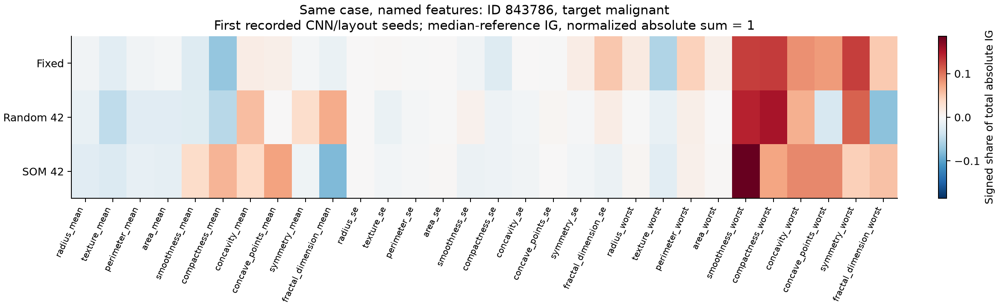
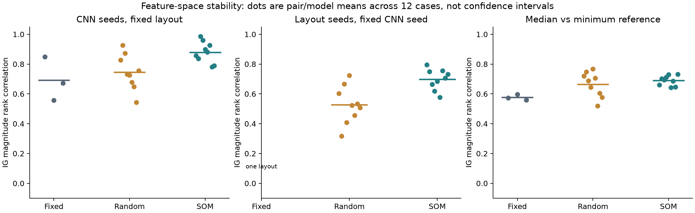
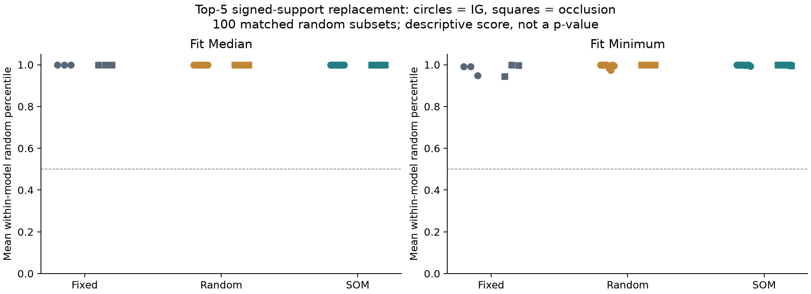

# Experiment 08: feature attribution across fixed, random and SOM layouts

2 November 2026. This study follows the [SOM2IMG layout experiment](../07_som2img_layout/README.md) using its saved models, mappings and evaluation partition. No classifier or layout was retrained.

[Protocol](protocol.json) · [Detailed results](results.json) · [Analysis code](../../scripts/som2img_attributions.py) · [Tests](../../tests/test_som2img_attributions.py)

## Main finding

SOM models produced more consistent feature-attribution rankings than the fixed and random controls across CNN initializations in this experiment. With the fitting-median reference, mean Integrated Gradients (IG) magnitude-rank correlation across CNN seeds was **0.880 for SOM, 0.745 for random layouts and 0.693 for the fixed grid**. Across layout seeds at a fixed CNN seed, SOM also had higher agreement than random layouts: **0.698 versus 0.527**.

However, three observations limit the interpretation. First, changing the attribution reference changed the rankings and their signs. Second, replacing highly ranked features outperformed random replacement for every layout, leaving this diagnostic with little ability to distinguish them. Third, some magnitude agreement persisted after a full model reset, especially for SOM. The results support further investigation of stability, but do not establish that SOM explanations are more faithful or biologically meaningful.

All numerical findings below come from [results.json](results.json). The linked literature supplies the attribution definitions and motivation for controls, not these experimental results.

## 1. Question and design

The question is whether the better organized SOM layouts from Experiment 07 also yield more consistent feature explanations. The comparison separates four sources of variation: CNN initialization, layout initialization, explanation reference and attribution method.

| Component | Setting |
|---|---|
| Dataset | Wisconsin Diagnostic: 30 cell-morphology features, not gene expression |
| Models | All 21 Experiment 07 CNNs: 3 fixed, 9 random and 9 SOM |
| Model verification | State hashes checked; all saved probabilities on the 86 evaluation records reproduced exactly before attribution |
| Selected cases | First six benign and first six malignant records in saved evaluation order, giving the same 12 cases for every model |
| Fitting data | Existing 318-row fitting partition; used to define references only |
| Checkpoint partition | Existing 79-row inner-stop partition; no new model selection |
| Excluded data | Previous 86 learning-test records excluded from transformation and scoring |
| Target score | Recorded-class logit margin, held fixed for each case across every comparison |
| References | Coordinatewise fitting median; alternate featurewise fitting minima, represented by zeros after scaling |
| Methods | Integrated Gradients and single-feature occlusion |

The target is `(2*y − 1) × (logit_M − logit_B)`, where `y=0` is benign and `y=1` is malignant. Positive attribution supports the recorded class relative to the reference. The target does not switch when a model predicts incorrectly. This differs from Experiment 03's original-predicted-class target, so its attribution scores are not directly comparable.

The selection retained an incorrect prediction: `SnakeRandom_42_cnn_20261024` classified malignant case 848406 as benign. Overall, the selected cases were correctly classified in 36/36 fixed, 107/108 random and 108/108 SOM model-case observations. These are repeated evaluations of **12 cases**, not 252 independent patients or a new accuracy benchmark.

The protocol was recorded before computing these explanations, after Experiment 07's predictive results were already known. This is an exploratory follow-up, not a preregistered confirmatory study. Source and model hashes are included in the results.

## 2. Attribution and tracing

IG estimates feature contributions along a path from a reference to the input. I used the existing Captum implementation with 512 Gauss–Legendre steps, increasing to 1,024 or 2,048 only under the specified completeness-residual rule. The reference is defined in feature space and then placed through each saved mapping. The decoded attribution vectors therefore share the same original feature order. [IG paper](https://arxiv.org/abs/1703.01365); [Captum IG definition](https://captum.ai/api/integrated_gradients.html).

Single-feature occlusion replaces one input value with its reference and records the score change. Captum's patch shape was `(1, 1, 1)`, so each intervention affects one channel and one pixel. Every decoded result was also checked against direct replacement of the corresponding named feature. Unlike IG, these individual score changes need not sum to the full input–reference score difference. [Captum Occlusion definition](https://captum.ai/api/occlusion.html).

Neither method establishes causation. In particular, a pixel's coordinate identifies its source feature but does not make the surrounding region a biological mechanism. Grad-CAM was not added to this comparison because its regional localization would introduce a different attribution unit; its limitations were examined in [Experiment 03](../03_wisconsin_explanations/README.md).



The illustration uses the first selected case and first recorded CNN/layout seeds, not a model chosen for an attractive map. Each row is normalized to unit absolute sum for display only; raw signed vectors are retained in the results. Red supports the malignant target in this example and blue opposes it. The normalization prevents this figure from comparing absolute score magnitudes across models.

## 3. Stability results

The primary rank metric is Spearman correlation of absolute attribution values. Signed Spearman and absolute top-5 Jaccard overlap are also retained. Constant vectors receive undefined metrics rather than artificial perfect agreement. Ties are ordered by original feature index.

For CNN-seed stability, every pair of CNN seeds is compared within a fixed layout. For layout-seed stability, every pair of layouts is compared within the same method and CNN seed. Each comparison uses the same case, class score, reference and original feature order.

| IG comparison | Fixed | Random | SOM |
|---|---:|---:|---:|
| CNN-seed magnitude correlation, median reference | 0.693 | 0.745 | 0.880 |
| CNN-seed magnitude correlation, minimum reference | 0.692 | 0.720 | 0.825 |
| Layout-seed magnitude correlation, median reference | Not applicable | 0.527 | 0.698 |
| Layout-seed magnitude correlation, minimum reference | Not applicable | 0.460 | 0.626 |
| CNN-seed top-5 Jaccard, median reference | 0.531 | 0.498 | 0.724 |
| Layout-seed top-5 Jaccard, median reference | Not applicable | 0.319 | 0.442 |

Only one fixed layout exists, so it has no layout-seed comparison. Median-reference CNN comparisons contain 3 pairs for fixed and 9 each for random and SOM, with 12 cases per pair. Each stochastic method has 9 layout comparisons, again using those same cases. Means are descriptive; the repeated cases and overlapping model pairs are dependent.



The ordering also appears with single-feature occlusion. Its median-reference magnitude correlation across CNN seeds is 0.664, 0.756 and 0.861 for fixed, random and SOM, respectively. Across layout seeds, it is 0.537 for random and 0.681 for SOM. Agreement between the two attribution methods within a model is high: median-reference magnitude correlation averages 0.887, 0.949 and 0.967.

These results show greater consistency in the SOM pipeline under the tested settings. They do not isolate an explanation algorithm's error: changing a layout or CNN seed also changes the fitted function being explained. The original study has only three layout seeds and three CNN seeds, and every model shares the same small data split.

## 4. Reference sensitivity and model dependence

| IG diagnostic | Fixed | Random | SOM |
|---|---:|---:|---:|
| Median vs minimum: magnitude correlation | 0.577 | 0.664 | 0.690 |
| Median vs minimum: signed correlation | 0.335 | 0.267 | 0.306 |
| Trained vs reset: magnitude correlation | 0.321 | 0.508 | 0.626 |
| Trained vs reset: signed correlation | 0.153 | 0.191 | 0.261 |
| Trained vs reset: top-5 Jaccard | 0.155 | 0.254 | 0.373 |
| IG vs model-free input–median distance: magnitude correlation | 0.631 | 0.655 | 0.718 |

Reference changes affect the question the attribution answers. The relatively low signed agreement shows that magnitude-only rankings hide some of this change. Both references are constructed vectors; neither is guaranteed to describe a real patient. IG explicitly includes the input-minus-reference difference, so agreement with that model-free vector is a useful caution when interpreting stable magnitudes. [Captum IG](https://captum.ai/api/integrated_gradients.html).

The reset control replaces all learned weights with an untrained CNN using `cnn_seed + 9100`. Layouts sharing a CNN seed also share the reset weights. The target and median reference remain unchanged. The partial agreement with the trained explanation means that stability cannot be attributed entirely to learned model behavior. It does **not** show that the trained model is irrelevant or that IG fails generally: signed agreement is lower, and only one reset realization per CNN seed was tested. Parameter-dependence testing is motivated by [Adebayo et al.](https://arxiv.org/abs/1810.03292); this is not a reproduction of their complete test suite.

## 5. Feature-replacement diagnostic

For each model, case and reference, I ranked features by signed support for the fixed target and replaced the top 1, 3 or 5 with that reference. The score drop was compared with 100 random feature subsets of the same size. All layouts and references used the same random subsets for a given case and subset size.

| Five-feature replacement | Fixed | Random | SOM |
|---|---:|---:|---:|
| Median-reference IG exceeds random mean | 36/36 | 108/108 | 108/108 |
| Median-reference occlusion exceeds random mean | 36/36 | 108/108 | 108/108 |
| Mean IG random percentile, median reference | 1.0000 | 0.9999 | 1.0000 |
| Mean IG random percentile, minimum reference | 0.9769 | 0.9946 | 0.9989 |

Both methods also exceeded the random mean in all model-case observations under the minimum reference. A percentile of 1 means that the selected intervention produced a larger drop than all 100 sampled random interventions. It is a descriptive within-model comparison, not a p-value or a statement about every possible subset. Raw score drops and all random drops are retained, but raw logit scales differ across models and should not be treated as directly comparable effect sizes.



The near-ceiling results suggest that this control is too weak to distinguish the layouts on these cases. In addition, occlusion and replacement use closely related interventions, so their agreement is not independent validation. Replacing correlated features separately can create unrealistic combinations; a large score change under that intervention does not establish a biological effect.

## 6. Verification

- All 21 checkpoint state hashes matched Experiment 07. Reloaded predictions reproduced its saved 86-case probabilities exactly, and attribution left the trained weights unchanged.
- All 756 IG calculations, including both references and the reset controls, met the specified normalized completeness tolerance of 0.001. There were 754 calculations at 512 steps and two at 1,024; none needed 2,048. The maximum normalized residual was 0.000910. Numerical completeness is a computation check, not validation of the reference or biological meaning.
- Captum occlusion and direct named-feature replacement differed by at most 2.38×10⁻⁷.
- Analytic tests recover known linear effects, preserve decoded explanations under joint coordinate/weight permutation, check fixed targets and verify zero contribution for unchanged reference coordinates.
- All **112 project tests** pass, including 18 new tests. Ruff passes for the new script and tests. Existing style warnings in the older MILE files remain outside this change.
- A separate full execution reproduced `results.json` and all three figures byte-for-byte. Figures were visually checked. Earlier experiment results, source files and model checkpoints remain unchanged.

## 7. Interpretation and next step

This milestone completes feature-name tracing and controlled explanation comparisons for the author-code SOM layouts. It provides a preliminary stability result, alongside evidence that reference choice and model-independent structure still matter. It does not establish novelty, superiority to tabular explanations, genomic usefulness or a clinical conclusion.

The next experiment should strengthen the controls before extending to genomic data. A useful first step is to compare IG against a model-free input–reference-distance ranking under the same replacement test, and repeat the explanation with references drawn from actual fitting records. A later group-level intervention can ask whether related features matter jointly while addressing unrealistic independent replacement. These are proposed follow-ups, not results of the present protocol.

For my advisor, the key question is whether this combination of mapping integrity, stability and model-dependence checks is the right foundation for the thesis's biological interpretation criteria. The complete multi-dataset thesis evaluation remains separate from this learning study.

## Reproduction

Use the existing Python 3.12 environment in [requirements-learning.txt](../../requirements-learning.txt). No dependency upgrade was required. The verified Wisconsin raw files and all 21 Experiment 07 checkpoints must be present locally. The runner uses the saved feature maps and does not refit or import the author implementation.

Choose a new output directory; the runner refuses to overwrite an existing result:

```sh
MPLCONFIGDIR=/private/tmp/css700-matplotlib XDG_CACHE_HOME=/private/tmp/css700-cache .venv/bin/python -m scripts.som2img_attributions --output-dir outputs/som2img-attribution-repeat
cmp experiments/08_som2img_attributions/results.json outputs/som2img-attribution-repeat/results.json
MPLCONFIGDIR=/private/tmp/css700-matplotlib XDG_CACHE_HOME=/private/tmp/css700-cache .venv/bin/python -m unittest discover -s tests -q
.venv/bin/python -m ruff check scripts/som2img_attributions.py tests/test_som2img_attributions.py
```

The detailed JSON contains all per-feature vectors, reference values, model/case diagnostics, random replacement drops, pairwise comparisons and environment/source hashes. The larger file size preserves the evidence needed to inspect or recompute the summaries; raw datasets and checkpoints remain excluded from Git.
