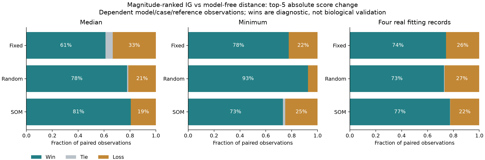
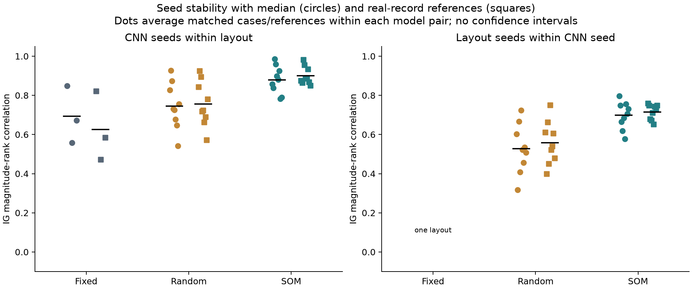
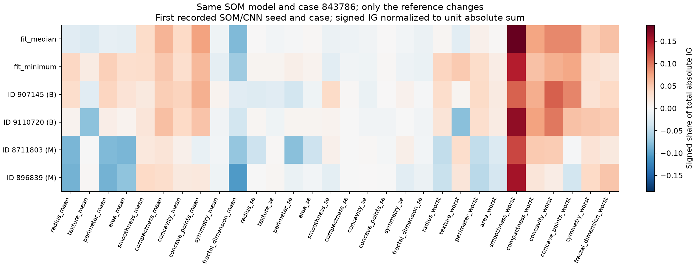

# Experiment 09 — reference and model-free controls

Computed 2 November 2026; reviewed and documented 4 November 2026.

This follow-up asks whether the explanation results in [Experiment 08](../08_som2img_attributions/README.md) remain informative when compared with a stronger control and references drawn from actual fitting records. All 21 CNNs remain frozen. The study provides evidence about reference choice and model-dependent ranking, not biological validation.

## Motivation

Experiment 08 found greater IG magnitude stability for SOM layouts, but the signed-support replacement test was near its ceiling for almost every layout. Attribution magnitudes also correlated with input–reference distance, including after resetting model weights. A stronger comparison was therefore needed before interpreting consistency as explanation quality.

IG attributes a chosen output relative to a reference, and its usual formulation includes the input-minus-reference factor. Reference selection changes the contrast being explained. The method and numerical check follow [Sundararajan et al.](https://arxiv.org/abs/1703.01365) and [Captum's IG documentation](https://captum.ai/api/integrated_gradients.html). The discussion of reference distributions and ablation limitations draws on [Sturmfels et al.](https://distill.pub/2020/attribution-baselines/). The four-record selection, distance control and comparison design are specific to this study.

## Protocol

The [protocol](protocol.json) was recorded after reviewing Experiment 08 and before computing this follow-up. This is exploratory work, not a confirmatory preregistration.

| Component | Setting |
|---|---|
| Dataset | Wisconsin Diagnostic, 30 morphology features |
| Models | 3 fixed-grid, 9 lossless random-layout and 9 SOM-layout CNNs from Experiment 07 |
| Cases | The same twelve Experiment 08 evaluation cases; no reselection |
| Target | Recorded-class logit margin, `(2*y − 1) × (logit_M − logit_B)`, including incorrect predictions |
| References | Fitting median, fitting minimum and four fitting records selected with seed 20261102 |
| Real references | Two benign and two malignant records from the 318-row fitting partition only |
| New computation | 1,008 real-reference IG vectors; 504 median/minimum vectors reused unchanged |
| Replacement | Top five features replaced by the same reference used for attribution |
| Primary comparison | Absolute IG ranking versus absolute scaled input–reference distance |
| Random control | 100 five-feature subsets per case, shared across all models and references |
| Excluded data | The previous 86 learning-test records remain excluded from scoring |

The real references are fitting positions 236 and 251 (benign, sample IDs 907145 and 9110720) and positions 93 and 187 (malignant, IDs 8711803 and 896839). Positions refer to the saved fitting partition. Their identities and feature values are retained in [results.json](results.json). This small balanced collection is not an estimate of the full fitting distribution. Attributions are evaluated separately for each reference, not averaged into an expected-gradients estimator.

For each model, case and reference, the primary outcome compares the absolute change in the fixed target score after replacing the five selected features. A win means that the IG-selected intervention produced a larger absolute change than the distance-selected intervention; it does not mean that IG found causal features. Numerical ties use the tolerance in the protocol. A secondary signed-support comparison is retained in the JSON, but is not treated as a fair directional contest against unsigned distance.

Random percentiles use the midrank of each observed absolute change among 100 random changes. These percentiles describe the sampled interventions; they are not p-values. The random bank differs from Experiment 08, which consumed draws for smaller subset sizes first.

## Replacement results

| Layout | Reference | IG wins / ties / losses | Mean IG percentile | Mean distance percentile |
|---|---|---:|---:|---:|
| Fixed | Median | 22 / 2 / 12 | 0.8669 | 0.8442 |
| Fixed | Minimum | 28 / 0 / 8 | 0.9539 | 0.9058 |
| Fixed | Four real records | 107 / 0 / 37 | 0.8935 | 0.7825 |
| Random | Median | 84 / 1 / 23 | 0.8766 | 0.7589 |
| Random | Minimum | 100 / 0 / 8 | 0.9819 | 0.7866 |
| Random | Four real records | 314 / 2 / 116 | 0.8840 | 0.7994 |
| SOM | Median | 87 / 0 / 21 | 0.8819 | 0.8821 |
| SOM | Minimum | 79 / 2 / 27 | 0.9878 | 0.9654 |
| SOM | Four real records | 334 / 1 / 97 | 0.8731 | 0.7958 |



With real references, IG wins more comparisons than it loses for every layout family. However, the result depends on the reference and the summary measure. For SOM with the median reference, IG wins 87 of 108 comparisons, yet its mean random percentile is slightly below distance. Win counts record direction, whereas the mean percentile reflects the size of changes in relative position among random interventions. Neither summary should be substituted for the other.

There are only twelve underlying cases. Models share data, cases repeat across models and references, and comparisons are dependent. The larger observation counts are not additional independent patients. Absolute logit changes are compared within each matched model/case/reference, not used to rank different models by explanation quality.

## Stability and reference sensitivity

| Mean absolute IG Spearman correlation | Fixed | Random | SOM |
|---|---:|---:|---:|
| CNN seeds, median reference | 0.693 | 0.745 | 0.880 |
| CNN seeds, real references | 0.626 | 0.757 | 0.901 |
| Layout seeds, median reference | Not applicable | 0.527 | 0.698 |
| Layout seeds, real references | Not applicable | 0.558 | 0.715 |

Each stability comparison keeps the case, target and reference fixed. The real-reference rows average comparisons across the four references; they do not correlate vectors made from different references. Only one fixed layout exists, so it has no layout-seed comparison.



SOM retains the highest mean magnitude agreement under this design. The result concerns consistency across fitted functions, not an explanation's agreement with a known biological truth.

Within the same SOM model and case, signed agreement averages 0.656 between real references of the same class, but 0.020 between references from different classes. Absolute agreement is 0.631 and 0.433, respectively; top-five Jaccard is 0.463 and 0.263. Reference choice therefore changes both direction and ranking. Different reference classes define different contrasts, so disagreement alone is not a failure of the attribution method.



The example uses the first recorded SOM/CNN seeds and first selected case. Each row is normalized to unit absolute sum for display; the raw signed vectors remain in the JSON. The figure cannot compare raw attribution magnitudes across references.

## Numerical checks and reproducibility

The new real-reference calculations used 512 Gauss–Legendre steps initially, with refinement to 1,024 or 2,048 under the existing completeness rule. Of 1,008 calculations, 971 stopped at 512 steps, 28 at 1,024 and nine at 2,048.

**One calculation did not meet the normalized residual tolerance of 0.001:** `Fixed_cnn_20261025`, sample 843786, reference `real_fit_93`. At 2,048 steps, the target-score difference was 0.24003220, the attribution sum was 0.24154043 and the normalized residual was 0.00150824. Normalization divides the absolute residual by `max(1, abs(score_difference))`. The vector is retained and flagged, and is included in the reported summaries as specified by the protocol. A sensitivity analysis excluding it has not been performed. Passing software tests does not remove this numerical exception.

- Model states, saved predictions, case identities and reused vectors were checked against Experiment 08. No model fitting or learning-test scoring was added.
- All 130 project tests passed during the 4 November review, including 18 new analytic and saved-evidence tests. These check reference selection, deterministic random subsets, known linear effects, cancellation, ties, reused vectors, hashes and recomputed summaries.
- Ruff passed for the new script and tests. Older files were not reformatted.
- The saved independent execution from 2 November matches `results.json` and all three PNGs byte-for-byte; this equality was rechecked on 4 November. A new full experiment execution was not necessary for the documentation cleanup.

Use the existing [Python environment](../../requirements-learning.txt), verified Wisconsin inputs and Experiment 07 checkpoints. Follow [Experiment 07](../07_som2img_layout/README.md) if those local prerequisites need to be recreated. The runner does not refit the models or import the upstream SOM package. Choose a new output directory; an existing result cannot be overwritten.

```sh
MPLCONFIGDIR=/private/tmp/css700-matplotlib XDG_CACHE_HOME=/private/tmp/css700-cache .venv/bin/python -m scripts.reference_controls --output-dir outputs/reference-controls-repeat
cmp experiments/09_reference_controls/results.json outputs/reference-controls-repeat/results.json
MPLCONFIGDIR=/private/tmp/css700-matplotlib XDG_CACHE_HOME=/private/tmp/css700-cache .venv/bin/python -m unittest discover -s tests -q
.venv/bin/python -m ruff check scripts/reference_controls.py tests/test_reference_controls.py
```

The detailed JSON retains vectors, real-reference identities, selected features, random subsets and score changes, numerical diagnostics, all comparisons, summaries and source/environment hashes. Its size preserves the evidence required to audit the tables. Duplicate verification outputs and model checkpoints remain outside Git.

## Interpretation and remaining work

This experiment strengthens the earlier controls. IG's replacement ranking often adds information beyond distance alone, and SOM's higher magnitude stability persists with real-record references. The median-reference result also shows why a favorable win count is insufficient on its own.

The study still uses twelve reused morphology cases and four selected references. Real endpoints do not guarantee realistic intermediate IG paths or hybrid replacement inputs. A large score response is intervention sensitivity, not automatically faithful or biologically meaningful interpretation. There is no new tabular-explanation comparison, genomic attribution, group intervention or evidence of novelty in this experiment.

Before another run, the next protocol should address a defined group-level question, correlated-feature replacement and the choice of contrast. The numerical exception also needs an explicit follow-up decision. The advisor's guidance is needed on biological interpretation criteria and the intended SOM2IMG paper/code version before treating these learning results as the final thesis evaluation.
